<!--
  Profile README for github.com/mrxvision97
  Static cards live in assets/ (regenerate: python scripts/cards.py static --out assets).
  Live cards (pulse, repo cards, snake) are built daily by .github/workflows/dashboard.yml
  into the `output` branch. Preview locally: bash scripts/preview.sh
-->

<picture>
  <source media="(prefers-color-scheme: dark)" srcset="assets/hero-dark.svg" />
  
</picture>

  
  
  
  

I build applications that create real impact, end to end: **idea → architecture → shipping → iteration**. AI, LLMs and agents are part of how I build, not the pitch. The pitch is software people actually use.

## Currently building

  <a href="https://unbordr.in"><picture><source media="(prefers-color-scheme: dark)" srcset="assets/build-unbordr-dark.svg" /></picture></a>
  <a href="https://experienceflywheel.ai"><picture><source media="(prefers-color-scheme: dark)" srcset="assets/build-flywheel-dark.svg" /></picture></a>
  <picture><source media="(prefers-color-scheme: dark)" srcset="assets/build-automations-dark.svg" /></picture>
  <picture><source media="(prefers-color-scheme: dark)" srcset="assets/build-fintech-dark.svg" /></picture>

### The automation crew

<picture>
  <source media="(prefers-color-scheme: dark)" srcset="assets/crew-dark.svg" />
  
</picture>

## Selected impact

<picture>
  <source media="(prefers-color-scheme: dark)" srcset="assets/impact-dark.svg" />
  
</picture>

<b>What's behind the numbers</b>

 

| Built | Result | Where |
|---|---|---|
| **Multimodal agentic chatbot platform**, from scratch | A/B tested with 50+ users, scaled to **100+ users**, **60% lower** operating cost through token optimisation | SDE Intern · Noww Club |
| **Multi-agent federated learning system**: 10 AI agents across 1,000+ nodes | **Runner-up, SuperHack 2025** out of 10,000+ teams ($7,000) | [Open source ↗](https://github.com/mrxvision97/MSP-Intelligence-Network-Federated-Learning-Approach) |
| **Multimodal framework** (text · audio · vision) with SHAP/LIME interpretability | **25% fewer** debugging cycles | AI/ML Intern · UST |
| **Underwater ship-hull detection** on 50K+ images for edge deployment | **+4%** accuracy, **+20%** inference speed | ML Intern · IIT Guwahati |
| **IoT failure prediction** | **89% precision** forecasting failures 4+ hours ahead, **40% less** unplanned downtime | AI Intern · Makonis |

## Recognition

<picture>
  <source media="(prefers-color-scheme: dark)" srcset="assets/recognition-dark.svg" />
  
</picture>

## Open source

<!-- ADD A PROJECT: 1) add {"repo": "<name>", "tagline": "<one line>"} to featured.json
                    2) copy one <a>…</a> line below and replace the repo name in all 3 places.
     Cards are generated by the dashboard workflow; run it once (Actions → Profile dashboard → Run workflow). -->

  <a href="https://github.com/mrxvision97/shiplog"><picture><source media="(prefers-color-scheme: dark)" srcset="https://raw.githubusercontent.com/mrxvision97/mrxvision97/output/repo-shiplog-dark.svg" /></picture></a>
  <a href="https://github.com/mrxvision97/breakproof"><picture><source media="(prefers-color-scheme: dark)" srcset="https://raw.githubusercontent.com/mrxvision97/mrxvision97/output/repo-breakproof-dark.svg" /></picture></a>

<picture>
  <source media="(prefers-color-scheme: dark)" srcset="assets/soon-dark.svg" />
  
</picture>

## Built behind closed doors

Most of what I ship lives in private repositories: product codebases, client automations and internal tools. The code stays private. The activity doesn't.

<picture>
  <source media="(prefers-color-scheme: dark)" srcset="https://raw.githubusercontent.com/mrxvision97/mrxvision97/output/pulse-dark.svg" />
  
</picture>

## Stack

<picture>
  <source media="(prefers-color-scheme: dark)" srcset="assets/stack-dark.svg" />
  
</picture>

  

<picture>
  <source media="(prefers-color-scheme: dark)" srcset="https://raw.githubusercontent.com/mrxvision97/mrxvision97/output/snake-dark.svg" />
  
</picture>
